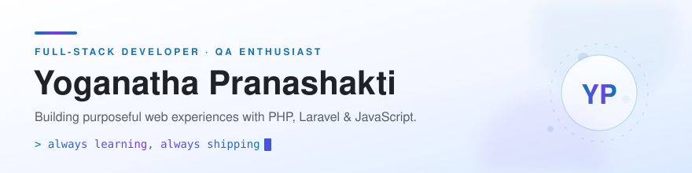

<picture>
  <source media="(prefers-color-scheme: dark)" srcset="https://raw.githubusercontent.com/YoganathaPranashakti/YoganathaPranashakti/main/assets/banner-dark.svg" />
  <source media="(prefers-color-scheme: light)" srcset="https://raw.githubusercontent.com/YoganathaPranashakti/YoganathaPranashakti/main/assets/banner-light.svg" />
  
</picture>

🌐 **[Visit my personal website](https://yoganatha-pranashakti.vercel.app/)**

## 📌 About Me

- 🔭 Currently working on **full-stack web applications and Progressive Web Apps (PWA)**
- 💬 Ask me about **PHP, Laravel, MySQL, JavaScript, system analysis (UML/SDLC), and black-box / SUS testing**
- ⚡ Fun fact: **I am a human-curious thinker / human-centric observer**
- 📄 [View my CV](https://drive.google.com/drive/folders/1NnnOonIQJQU1KSNm_Zy2RCBGSOWEtx1G?usp=drive_link)

## 📫 Connect With Me

- 🌐 **Website:** [yoganatha-pranashakti.vercel.app](https://yoganatha-pranashakti.vercel.app/)
- 📧 **Email:** [yoganathapranashakti@gmail.com](mailto:yoganathapranashakti@gmail.com)
- 💬 **Discord:** `yoganathapranashakti`
- 📱 **Phone:** [+62 821 2386 0193](tel:+6282123860193)
- 💼 **LinkedIn:** [yoganatha-pranashakti](https://www.linkedin.com/in/yoganatha-pranashakti/)
- 🐙 **GitHub:** [YoganathaPranashakti](https://github.com/YoganathaPranashakti)

## 🛠️ Languages & Tools

### 🌐 Frontend

          

          

### ⚙️ Backend

     

     

### 📱 Mobile

    

    

### 🗄️ Database

    

    

### 🎨 Tools & Design

    

    

## 💬 Quote of the Moment

  

